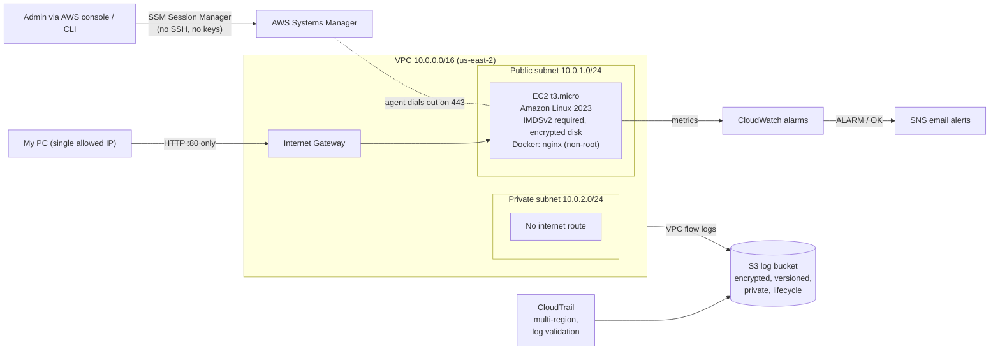

# Secure AWS Platform Lab

A secure, auditable AWS environment built entirely with **Terraform**, with a **DevSecOps pipeline** that scans infrastructure code, container images and scripts on every change.

> Self-directed lab project. Built and tested in a personal AWS account. No real or sensitive data.

## Architecture



## What's included

| File | What it builds |
|---|---|
| `network.tf` | VPC, public and private subnets, internet gateway, route tables, locked default security group |
| `compute.tf` | EC2 instance, least-privilege IAM role (SSM only), security group, Docker bootstrap |
| `logging.tf` | Encrypted, versioned, private S3 log bucket with lifecycle rules, CloudTrail, VPC flow logs |
| `monitoring.tf` | CloudWatch CPU and status-check alarms, SNS email notifications |
| `app/` | Non-root nginx container with a healthcheck |
| `scripts/` | Bash health-check and patch scripts |
| `.github/workflows/ci.yml` | CI pipeline: Terraform fmt/validate, Checkov, Trivy, ShellCheck |

## Security controls

| Control | How |
|---|---|
| No SSH | No port 22; administration only through SSM Session Manager, tied to IAM identity |
| Least privilege | EC2 role has only `AmazonSSMManagedInstanceCore`; CI token is read-only |
| Network restriction | Only inbound rule is HTTP from one IP; private subnet has no internet route |
| IMDSv2 required | Blocks tokenless metadata requests (verified: returns HTTP 401) |
| Encryption at rest | Encrypted EBS root volume; SSE-S3 on the log bucket |
| Audit logging | Multi-region CloudTrail with log file validation; VPC flow logs |
| Log protection | Public access blocked, versioning on, HTTPS-only bucket policy, writers scoped to this account |
| No secrets in Git | State, plan files and `*.tfvars` are git-ignored; CI needs no AWS credentials |
| Supply chain | Trivy action pinned to a commit SHA; container packages patched at build time |
| Container hardening | Runs as non-root user 101; unused `curl` removed |

## Accepted risks

Checkov findings that were reviewed and accepted, each documented with a `#checkov:skip` reason in the code:

| Check | Reason |
|---|---|
| CKV_AWS_88 (EC2 public IP) | Avoids NAT/VPC endpoint cost in a lab; no SSH, inbound HTTP from one IP only |
| CKV_AWS_144 (S3 replication) | Account is restricted to a single region by an organization SCP |
| CKV_AWS_18 (S3 access logging) | This is the central log bucket; logging it would need another bucket |
| CKV2_AWS_62 (S3 event notifications) | Not needed for an audit-log bucket |
| CKV_AWS_252 (CloudTrail SNS) | Per-file notifications would be noise; alerting is handled by CloudWatch |
| CKV2_AWS_10 (CloudTrail to CloudWatch Logs) | Logs centralized in S3 with integrity validation; deferred for cost |
| CKV_AWS_35, CKV_AWS_145, CKV_AWS_26 (KMS CMKs) | AWS-managed encryption in use; customer-managed KMS keys are a planned improvement |

## Prerequisites

- AWS account (this lab ran in `us-east-2`)
- Terraform 1.6+, AWS CLI v2, Git
- AWS CLI signed in (`aws login`, or another temporary-credential method)

## Deploy

```bash
# 1. Set your values (this file is git-ignored)
cp terraform.tfvars.example terraform.tfvars
# edit alert_email and my_ip_cidr  (find your IP: curl https://checkip.amazonaws.com)

# 2. Build
terraform init
terraform plan -out=lab.tfplan
terraform apply lab.tfplan
```

Then:
1. Confirm the **SNS subscription email** (required after every rebuild).
2. Wait about 5 minutes for the server to boot, then open the `web_url` output.

## Verify

```bash
# Flow logs and lifecycle rule
aws ec2 describe-flow-logs --query "FlowLogs[].[FlowLogId,FlowLogStatus]" --output table

# Alerting end to end (expect ALARM then OK emails)
aws cloudwatch set-alarm-state --alarm-name secure-lab-cpu-high --state-value ALARM --state-reason "test"
```

On the server (EC2 → Connect → SSM Session Manager):

```bash
sudo git -C /opt/lab pull
sudo bash /opt/lab/scripts/health-check.sh   # disk, memory, container, HTTP 200
sudo bash /opt/lab/scripts/patch.sh          # dnf updates, logged, no auto-reboot
```

Logs are written to `/var/log/lab-health.log` and `/var/log/lab-patch.log`.

## Destroy

```bash
terraform destroy
```

Destroy at the end of every session. Rebuilding takes about a minute.

## CI pipeline

Runs on every push to `main` and every pull request:

| Job | Checks |
|---|---|
| Terraform | `fmt -check`, `init -backend=false`, `validate` |
| Checkov | Infrastructure-as-code security misconfigurations |
| Trivy | Container image CVEs (fails on fixable CRITICAL/HIGH) |
| ShellCheck | Bash script correctness |

## Troubleshooting (problems actually hit)

| Symptom | Cause | Fix |
|---|---|---|
| `403 UnauthorizedOperation ... explicit deny in a service control policy` | Organization SCP restricts the account to one region | Tested `describe-vpcs` per region; moved everything to `us-east-2` |
| `terraform init` "succeeds" but no `.terraform.lock.hcl` | `providers.tf` was 0 bytes (never saved) | Check file sizes with `Get-ChildItem -Force`; enable Auto Save |
| `Unable to resolve action ... unable to find version` | Upstream action re-tagged after a supply-chain incident | Pin the action to a commit SHA |
| Trivy fails on CRITICAL/HIGH CVEs | Outdated Alpine packages in the base image | `apk upgrade` at build time; remove unused packages |
| No alarm emails | SNS subscription not confirmed (new topic on every rebuild) | Click **Confirm subscription** in the AWS email |
| Web page times out | Home IP changed; security group allows only the old one | Update `my_ip_cidr` in `terraform.tfvars`, plan and apply |
| `$'\r': command not found` in a script | Windows CRLF line endings | `.gitattributes` forces LF for `*.sh` |

## Production next steps

- Move EC2 to the private subnet with VPC endpoints for SSM
- Application Load Balancer with an ACM certificate (HTTPS)
- Customer-managed KMS keys for S3, CloudTrail and SNS
- Remote Terraform state in S3 with locking
- `terraform plan` in CI using GitHub OIDC (no stored AWS keys)
