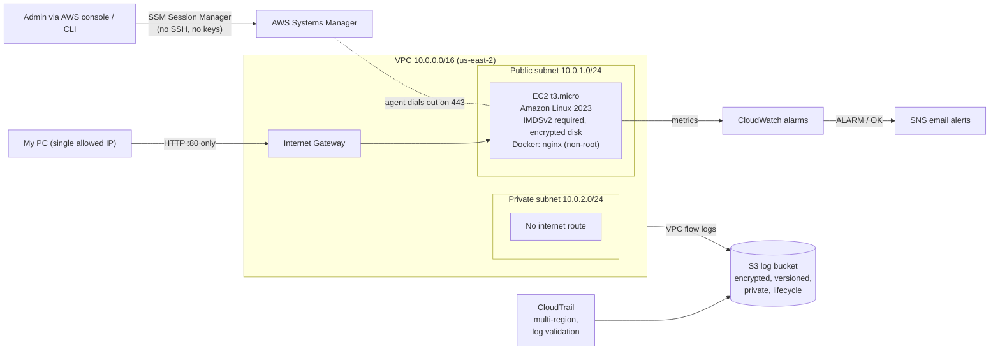

# Secure AWS Platform Lab

A secure, auditable AWS environment built entirely with **Terraform**, with a **DevSecOps pipeline** that scans infrastructure code, container images and scripts on every change.

> Self-directed lab project. Built and tested in a personal AWS account. No real or sensitive data.

## Architecture

## What's included

| File | What it builds |
|---|---|
| `bootstrap/` | One-time remote state bucket (encrypted, versioned, `prevent_destroy`) |
| `network.tf` | VPC, public and private subnets, internet gateway, route tables, locked default security group |
| `compute.tf` | EC2 instance, least-privilege IAM role (SSM only), security group, Docker bootstrap |
| `logging.tf` | Encrypted, versioned, private S3 log bucket with lifecycle rules, CloudTrail, VPC flow logs |
| `monitoring.tf` | CloudWatch CPU and status-check alarms, SNS email notifications |
| `app/` | Non-root nginx container with a healthcheck |
| `scripts/` | Bash health-check and patch scripts |
| `.github/workflows/ci.yml` | CI pipeline: Terraform fmt/validate, Checkov, Trivy, ShellCheck |

## Security controls

| Control | How |
|---|---|
| No SSH | No port 22; administration only through SSM Session Manager, tied to IAM identity |
| Least privilege | EC2 role has only `AmazonSSMManagedInstanceCore`; CI token is read-only |
| Network restriction | Only inbound rule is HTTP from one IP; private subnet has no internet route |
| IMDSv2 required | Blocks tokenless metadata requests (verified: returns HTTP 401) |
| Encryption at rest | Encrypted EBS root volume; SSE-S3 on the log and state buckets |
| Audit logging | Multi-region CloudTrail with log file validation; VPC flow logs |
| Log protection | Public access blocked, versioning on, HTTPS-only bucket policy, writers scoped to this account |
| State protection | Remote S3 state, encrypted and versioned, with S3-native locking |
| No secrets in Git | State, plan files and `*.tfvars` are git-ignored; CI needs no AWS credentials |
| Supply chain | Trivy action pinned to a commit SHA; container packages patched at build time |
| Container hardening | Runs as non-root user 101; unused `curl` removed |

## Accepted risks

Checkov findings that were reviewed and accepted, each documented with a `#checkov:skip` reason in the code:

| Check | Reason |
|---|---|
| CKV_AWS_88 (EC2 public IP) | Avoids NAT/VPC endpoint cost in a lab; no SSH, inbound HTTP from one IP only |
| CKV_AWS_144 (S3 replication) |